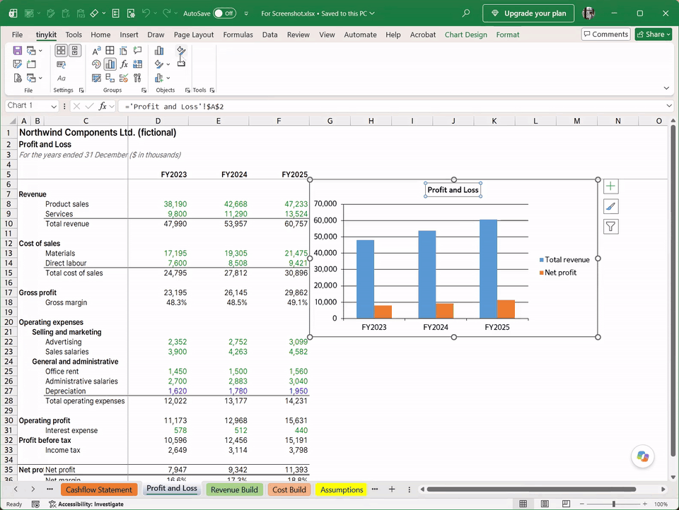
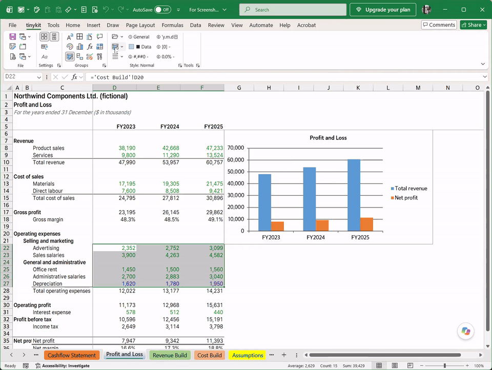
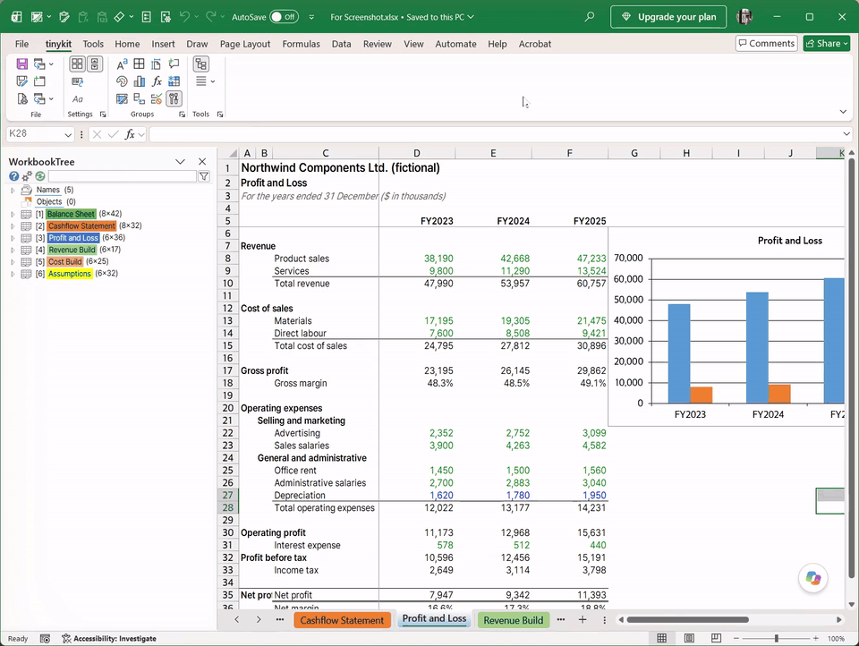
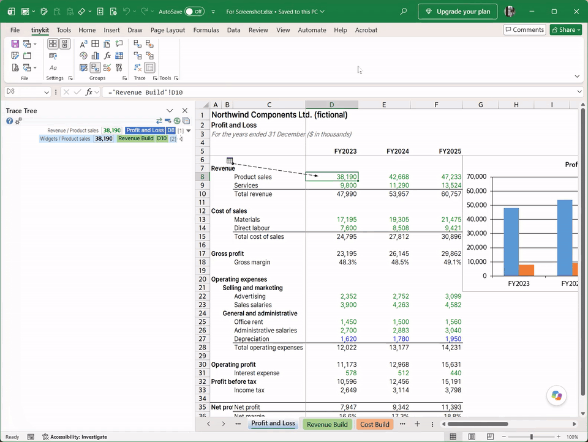
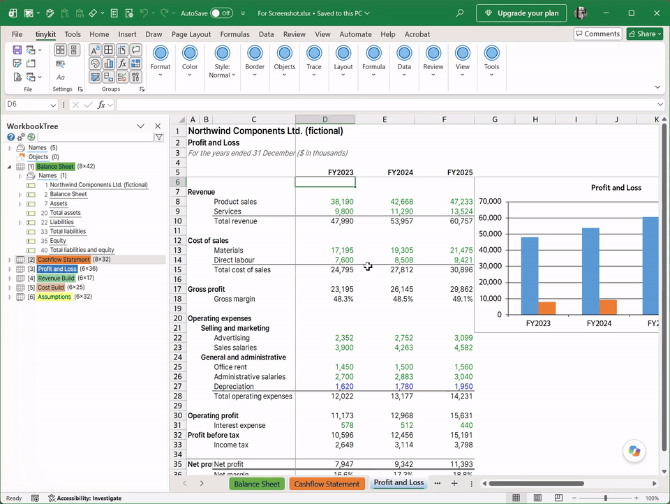

# tinykit for Excel

Small add-ins for Excel on Windows. They all add their groups to one **tinykit** ribbon tab.

| Add-in | What it does |
|---|---|
| **Main** (`tinykit.Excel.xll`) | The main add-in: the tinykit tab's working groups: File, Settings, Groups, Format, Color, Border, Objects, Layout, Formula, Data, Review, View and Tools - column widths, number formats, named colors, border pen, Fit Objects to Cells, the **Chart Editor** (a chart's title, axes, legend and series in one window, each change shown at once), Quick Layout, names tools, Customize View and more. Shift+click on a group's launcher shows or hides the labels of its tinykit buttons (**Settings > Toggle All tinykit Button Labels**: every group's). |
| **Styles** | The Styles group: the workbook's cell styles, six favorites, a style library that new workbooks take in, and Clean Up Styles. |
| **Tree** | *WorkbookTree*: a pane with the workbook's names, charts, tables and sheets, and each sheet's outline; selecting a node goes to it. It opens with every workbook (Settings > Open with every workbook to turn off) and its font can be picked. |
| **Trace** | Tracer arrows one level more or fewer for every selected cell (Alt+Z, Alt+X; with Shift fewer; Alt+C removes them), and the **Trace Tree** pane: a cell's precedents or dependents as a tree, with values, headings and formulas. |
| **DragScroll** | Ctrl+Alt+drag on a sheet scrolls it (with Shift: one way only). |

**Ctrl+Alt+Q** searches the commands of every tinykit add-in. **Settings > Custom Shortcuts** turns each keyboard
shortcut on or off. Tips of tinykit's own commands start with "[tinykit]".

### Main: Chart Editor

The vertical axis's Min changed, and the chart follows at once.

### Styles

A style from the gallery, then a favorite.

### Tree

Two letters in WorkbookTree's search, and a match picked goes there.

### Trace

Trace Tree down a level at a time with ← and back up with →, from Profit and Loss through Revenue Build to
Assumptions: Excel goes to each cell, the tracer arrows following.

### DragScroll

Ctrl+Alt+drag scrolls the sheet.

## Requirements

- Windows, Excel for Microsoft 365 or Excel 2016 or later (64-bit or 32-bit).
- [.NET 10 Desktop Runtime](https://dotnet.microsoft.com/download/dotnet/10.0) of the same bitness as Excel (most
  Excel installations are 64-bit: take **x64**).

## Install

1. Download `tinykit-excel-<version>.zip` from [Releases](https://github.com/juihn/tinykit-excel-releases/releases) and
   extract it.
2. Close Excel.
3. Double-click **Install.cmd**.

The add-ins are copied to `%LocalAppData%\tinykit\Excel\AddIns` for the current user (no administrator rights needed)
and load when Excel starts. To install only some of them, run in PowerShell:
`.\Install.ps1 -AddIn Main,Trace` (in 0.3.0 and earlier the main add-in is `Ribbon`: `-AddIn Ribbon,Trace`). To update, install the newer release the same way.

## Uninstall

Close Excel and double-click **Uninstall.cmd** (`.\Uninstall.ps1 -RemoveSettings` also deletes the settings and logs in
`%LocalAppData%\tinykit\Excel`).

## Settings and logs

Settings are kept in `%OneDriveConsumer%\.config\tinykit\Excel` when a personal OneDrive is there (so they follow you),
otherwise in `%LocalAppData%\tinykit\Excel`; logs in `%LocalAppData%\tinykit\Excel\logs`.

## License

Free for personal use; business use needs a paid license (ask through [Issues](https://github.com/juihn/tinykit-excel-releases/issues)). See [LICENSE.txt](LICENSE.txt). Third-party components: [THIRD-PARTY-NOTICES.txt](THIRD-PARTY-NOTICES.txt).
